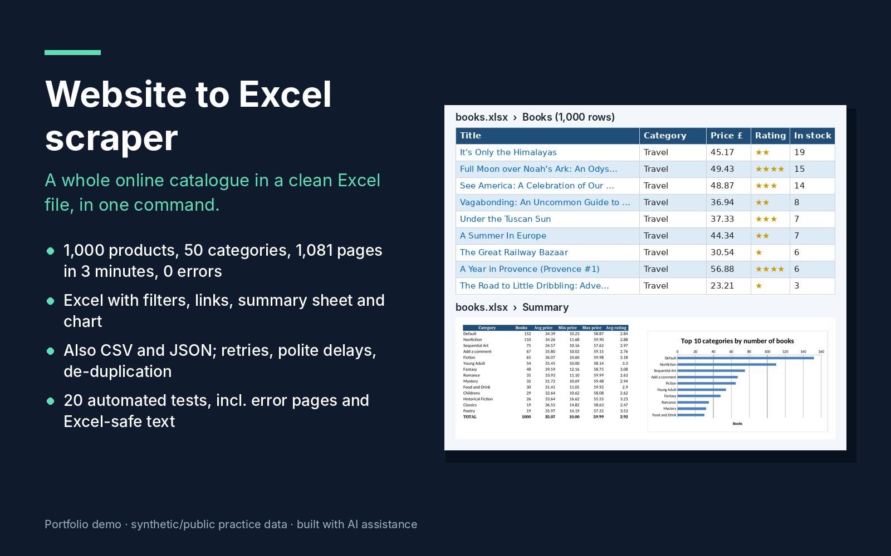
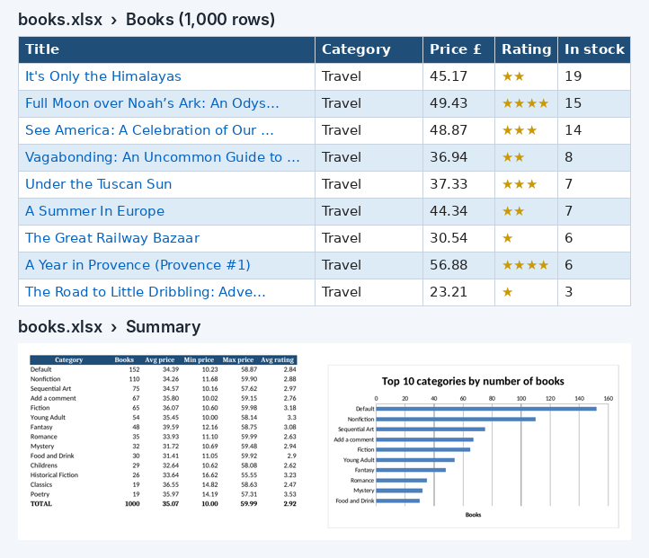

# Website → Excel scraper

Turns a whole online catalogue into a clean **Excel workbook**, plus CSV and JSON, in one command.



## What a real run produced

Target: [books.toscrape.com](https://books.toscrape.com), a public site built for scraping practice.

| | |
|---|---|
| Products | **1,000** from **50** categories |
| Pages visited | 1,081 (category pages + every product page) |
| Time | ~3 minutes at a polite 0.1 s delay |
| Failed pages | 0 |

Download the actual output: [books.xlsx](examples/books.xlsx) · [books.csv](examples/books.csv) · [books.json](examples/books.json)

The exact command was `python scraper.py --details --delay 0.1 --out examples`; the run report (pages, failures, duplicates, seconds) is saved at the top of `books.json`.

**In the Excel file**
- **Books** sheet: title, category, price, rating, stock, clickable product link, UPC, description; filters and frozen header.
- **Summary** sheet: number of books, average / min / max price and average rating per category, totals, and a chart of the top 10 categories.

## Run it

```sh
pip install -r requirements.txt
python scraper.py                                  # all categories -> output/
python scraper.py --category Poetry --limit 20     # quick test
python scraper.py --details                        # also open every product page (UPC, stock, description)
```

## Built to run unattended

- **Polite and resilient:** delay between requests, automatic retries with back-off on 429/5xx, timeouts, an honest User-Agent.
- **Correct text:** the site sends no charset, so a naive scraper turns `£` into `£`; this one decodes UTF-8 explicitly. The CSV opens correctly in Excel.
- **No duplicates, no silent gaps:** products are de-duplicated by URL. Pages that fail to load, listing pages that come back without products (an error or maintenance page) or with an unexpected layout, and product pages missing their UPC or stock line are listed in the run report instead of crashing the run or being skipped quietly.
- **No half-written files:** each output is written to a temporary file and swapped in only when complete.
- **Safe to open in Excel:** scraped text that starts like a formula (`=`, `+`, `-`, `@`) is stored as plain text, so a hostile product title cannot run as a formula when someone opens the file.
- **Tested:** 20 automated tests on saved and synthetic pages (pagination, prices, ratings, product pages, duplicates, error and truncated pages, formula-like text, exports) plus a live smoke test: `pip install -r requirements-dev.txt && LIVE=1 pytest`.

## Adapting it to another site

Most catalogue and listing sites follow the same shape: categories → paginated lists → detail pages. For a new site you change the CSS selectors in `parse_listing` and `parse_detail`; crawling, retries, de-duplication and exports stay as they are. Sites behind logins or CAPTCHAs, or whose terms forbid automated access, are out of scope.

## Why selectors and not an "AI scraper"

LLM scrapers that take a plain-English prompt are popular, so I measured one against this scraper on the same 19 book pages (Poetry category, 16 Nov 2026): [ScrapeGraphAI](https://github.com/ScrapeGraphAI/Scrapegraph-ai) 2.1.4 with `gpt-4.1-mini`, temperature 0.

| | This scraper | ScrapeGraphAI |
|---|---|---|
| Time | 6.4 s | 81 s |
| Cost | $0 | $0.018 (about $1 per 1,000 books) |
| Title, price, currency, stock, UPC | 19 / 19 | 19 / 19 |
| Star rating | 19 / 19 | 2 / 19 |
| Description identical to the site | 19 / 19 | 2 / 19 |
| Dependencies | 3 packages | ~100 packages, Python ≥ 3.12 |

- **Ratings:** the site shows stars only through a CSS class (`star-rating Four`). The LLM tool converts the page to text, the class is lost, and the model guesses — mostly "3".
- **Descriptions:** the model silently "tidied" the text (dropped a repeated passage and the trailing "...more" that are really on the site, changed apostrophes) and in two cases moved sentences around. The data no longer matched the source, and nothing flagged it.

Takeaway: for a catalogue you collect in bulk or on a schedule, explicit selectors are faster, free to run and exact. An LLM extractor is useful for a quick one-off across many differently built sites, for text fields only and with spot checks against the page.

The reference is this scraper's own output, so its 19 / 19 is by construction; the two failure types were checked against the live pages. Script and per-page results: [`benchmarks/scrapegraphai/`](benchmarks/scrapegraphai/).

---
Portfolio demo built with AI assistance. Data comes from a public practice site; no client data.
